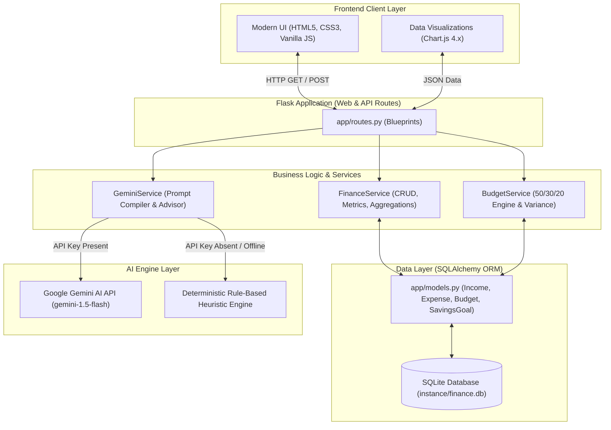
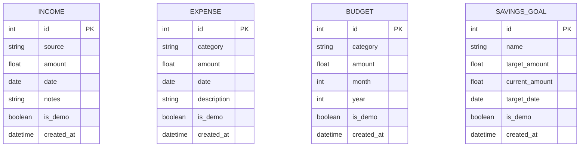

# Personal Finance Advisor Bot - Complete Project Documentation

**Project Name:** Personal Finance Advisor Bot  
**Repository:** [https://github.com/Kietai2/Personal-Finance-Advisor-Bot](https://github.com/Kietai2/Personal-Finance-Advisor-Bot)  
**Tech Stack:** Python 3.10+, Flask, SQLAlchemy, SQLite, Chart.js, Google Gemini API, Gunicorn  
**Currency Standard:** Indian Rupee (`₹`)  

---

## Table of Contents

1. [Executive Summary & Problem Statement](#1-executive-summary--problem-statement)
2. [System Architecture & Design Patterns](#2-system-architecture--design-patterns)
3. [Database Schema & Data Dictionary](#3-database-schema--data-dictionary)
4. [Core Business Logic & Algorithms](#4-core-business-logic--algorithms)
   - [4.1 Deterministic Budgeting Engine (50/30/20 Rule)](#41-deterministic-budgeting-engine-503020-rule)
   - [4.2 Savings Rate Calculation](#42-savings-rate-calculation)
   - [4.3 Over-Budget Warning System](#43-over-budget-warning-system)
   - [4.4 Gemini AI Advisor & Heuristics Resilience Engine](#44-gemini-ai-advisor--heuristics-resilience-engine)
5. [Complete API & Route Reference](#5-complete-api--route-reference)
6. [Local Environment Setup Guide](#6-local-environment-setup-guide)
7. [Cloud Deployment on Render (Step-by-Step)](#7-cloud-deployment-on-render-step-by-step)
   - [7.1 Render Start Command](#71-render-start-command)
   - [7.2 Render Build Command](#72-render-build-command)
   - [7.3 Environment Variables Setup](#73-environment-variables-setup)
   - [7.4 SQLite Storage & Persistence Consideration](#74-sqlite-storage--persistence-consideration)
8. [Automated Testing & Verification](#8-automated-testing--verification)
9. [College Project / Mentor Evaluation Q&A](#9-college-project--mentor-evaluation-qa)

---

## 1. Executive Summary & Problem Statement

### The Problem
Most college students, freelancers, and early-career individuals struggle with financial discipline due to:
- Lack of centralized visibility over disparate cash and digital transactions (UPI, net banking, cards).
- Ambiguous budget allocation: not knowing how much is safe to spend on discretionary items versus essentials.
- Disconnected advice: generic financial articles don't account for individual monthly cash flow or active milestone goals.

### The Solution
**Personal Finance Advisor Bot** is a full-stack financial management web application combining:
1. **Zero-friction tracking**: Fast CRUD interfaces for recording income and categorizing expenses.
2. **Deterministic budgeting**: Mathematical spending caps calculated from historical habits using the standard 50/30/20 framework.
3. **Hybrid AI Advisory**: Integration with Google Gemini API providing personalized, objective spending audits and reductions without human advisory liabilities.
4. **Resilient Architecture**: Zero-downtime offline fallback using an algorithmic heuristics engine if API keys or network services are unavailable.

---

## 2. System Architecture & Design Patterns

The application follows the **Application Factory & Service-Layer Architecture** (a specialization of MVC).



### Key Architectural Strengths
- **Decoupled Business Logic:** Routes only handle HTTP request parsing, validation, and rendering; computation is delegated to `FinanceService` and `BudgetService`.
- **Database Abstraction:** SQLAlchemy ORM allows seamless migration from local SQLite to PostgreSQL without modifying core query syntax.
- **Fail-Safe AI Integration:** The user experience is never blocked by external API outages or missing credentials.

---

## 3. Database Schema & Data Dictionary

The persistence layer uses SQLite with SQLAlchemy ORM models.



### Table Specifications

#### 1. `incomes`
| Column | Type | Nullable | Description |
|---|---|---|---|
| `id` | Integer | No (PK) | Auto-incrementing primary key |
| `source` | String(100) | No | Source (e.g., Salary, Freelance, Allowance, Business, Other) |
| `amount` | Float | No | Total received in ₹ (strictly > 0) |
| `date` | Date | No | Transaction date |
| `notes` | String(255) | Yes | Optional transaction notes |
| `is_demo` | Boolean | No (Default: False) | Flag separating demo data from user data |
| `created_at` | DateTime | No (Default: UTC now) | Record creation timestamp |

#### 2. `expenses`
| Column | Type | Nullable | Description |
|---|---|---|---|
| `id` | Integer | No (PK) | Auto-incrementing primary key |
| `category` | String(100) | No | Standard category (Food, Rent, Transport, Utilities, etc.) |
| `amount` | Float | No | Amount spent in ₹ (strictly > 0) |
| `date` | Date | No | Transaction date |
| `description` | String(255) | Yes | Description of item or merchant |
| `is_demo` | Boolean | No (Default: False) | Flag separating demo data from user data |
| `created_at` | DateTime | No (Default: UTC now) | Record creation timestamp |

#### 3. `budgets`
| Column | Type | Nullable | Description |
|---|---|---|---|
| `id` | Integer | No (PK) | Auto-incrementing primary key |
| `category` | String(100) | No | Target expense category |
| `amount` | Float | No | Monthly spending ceiling in ₹ |
| `month` | Integer | No | Month (1 - 12) |
| `year` | Integer | No | Calendar Year (e.g., 2026) |
| `is_demo` | Boolean | No (Default: False) | Flag separating demo data from user data |
| `created_at` | DateTime | No (Default: UTC now) | Record creation timestamp |

#### 4. `savings_goals`
| Column | Type | Nullable | Description |
|---|---|---|---|
| `id` | Integer | No (PK) | Auto-incrementing primary key |
| `name` | String(100) | No | Milestone title (e.g., Emergency Fund, Laptop) |
| `target_amount` | Float | No | Target savings goal in ₹ |
| `current_amount` | Float | No (Default: 0.0) | Current accumulated savings in ₹ |
| `target_date` | Date | Yes | Projected target completion date |
| `is_demo` | Boolean | No (Default: False) | Flag separating demo data from user data |
| `created_at` | DateTime | No (Default: UTC now) | Record creation timestamp |

---

## 4. Core Business Logic & Algorithms

### 4.1 Deterministic Budgeting Engine (50/30/20 Rule)
Instead of generating unverified numbers, the system implements a deterministic financial engineering model:
- **Needs (50% of Inflow):** Rent, Food, Utilities, Transport, Healthcare, Bills.
- **Wants (30% of Inflow):** Entertainment, Shopping, Dining Out, Other.
- **Savings (20% of Inflow):** Emergency reserves, investments, goal deposits.

#### Mathematical Formulation:
Let $I_{\text{month}}$ be total monthly income and $H_c$ be historical average expenditure in category $c$:
$$\text{Baseline Cap}_c = \begin{cases} 
0.50 \times I_{\text{month}} \times w_c & \text{if } c \in \text{Needs} \\
0.30 \times I_{\text{month}} \times w_c & \text{if } c \in \text{Wants}
\end{cases}$$
where $w_c$ is the weighted proportion based on trailing 3-month spending.

The engine returns:
1. `recommended_budget`: Explicit ₹ limits per category.
2. `audit_trail`: Human-readable formula derivation for academic and mentor evaluation.

### 4.2 Savings Rate Calculation
$$\text{Net Savings} = \text{Total Income} - \text{Total Expenses}$$

$$\text{Savings Rate (\%)} = \begin{cases} 
\left(\frac{\text{Net Savings}}{\text{Total Income}}\right) \times 100 & \text{if Total Income} > 0 \\
0 & \text{otherwise}
\end{cases}$$

### 4.3 Over-Budget Warning System
For each budgeted category $c$:
$$\text{Utilization Percentage} = \left(\frac{\text{Actual Spent}_c}{\text{Budget Limit}_c}\right) \times 100$$
- **Normal:** $< 80\%$ (Green badge)
- **Warning:** $80\% \le \text{Utilization} \le 100\%$ (Yellow badge)
- **Over-Budget:** $> 100\%$ (Red badge indicating deficit)

### 4.4 Gemini AI Advisor & Heuristics Resilience Engine
The AI advisor accepts structured financial payloads including:
- Current Monthly Inflows & Outflows
- Category Breakdown with percentages
- Budget Limits vs Actuals
- Month-over-Month Variance
- Milestone Goals & Completion Percentages

#### Prompt Engineering & Safety Guardrails:
1. **Compliance Rule:** The bot strictly prepends and appends educational disclaimers. It is banned from giving legal or registered investment advice (SEBI/SEC compliance standards).
2. **Deterministic Heuristics Fallback:** If `GEMINI_API_KEY` is not supplied or network connectivity fails, `GeminiService.generate_fallback_advice()` takes over and produces instant, structured 6-section advice generated from mathematical rules.

---

## 5. Complete API & Route Reference

### Web Page Routes (UI Controllers)
| Route | Method | Description |
|---|---|---|
| `/` | GET | Executive Dashboard with KPI cards and Chart.js analytics |
| `/income` | GET, POST | Income stream manager (filter, add, edit, delete) |
| `/expenses` | GET, POST | Expense tracker with category breakdown |
| `/budgets` | GET, POST | Monthly budget allocator and auto-generator |
| `/savings` | GET, POST | Milestone tracker and quick contribution manager |
| `/advisor` | GET | Dedicated AI Financial Advisor console |
| `/reports` | GET | Monthly Financial Statement with printable layout |
| `/transactions` | GET | Unified ledger with multi-column search & sorting |

### REST & Action Endpoints
| Route | Method | Payload / Params | Response |
|---|---|---|---|
| `/api/advisor/analyze` | POST | `{ "prompt": string }` (optional) | `{ "success": true, "analysis": string, "source": "gemini"|"heuristics" }` |
| `/api/budgets/auto-generate` | POST | `{ "month": int, "year": int }` | `{ "success": true, "suggestions": [...], "explanation": string }` |
| `/api/budgets/apply` | POST | `{ "budgets": { "Category": amount } }` | `{ "success": true, "message": string }` |
| `/api/goals/<id>/contribute` | POST | `{ "amount": float }` | `{ "success": true, "new_amount": float }` |
| `/demo/load` | POST | None | Redirects to `/` with ₹35k demo dataset loaded |
| `/demo/clear` | POST | None | Clears all records flagged with `is_demo=True` |
| `/transactions/export` | GET | Query params: `month`, `year` | Downloads `transactions.csv` |

---

## 6. Local Environment Setup Guide

Follow these steps to run the application on your local machine:

### Step 1: Clone the Repository
```bash
git clone https://github.com/Kietai2/Personal-Finance-Advisor-Bot.git
cd personal-finance-advisor
```

### Step 2: Create a Virtual Environment
```bash
# On Windows
python -m venv .venv

# On macOS/Linux
python3 -m venv .venv
```

### Step 3: Activate the Virtual Environment
```bash
# Windows PowerShell
.\.venv\Scripts\Activate.ps1

# Windows Command Prompt
.\.venv\Scripts\activate.bat

# macOS / Linux
source .venv/bin/activate
```

### Step 4: Install Dependencies
```bash
pip install -r requirements.txt
```

### Step 5: Configure Environment Variables
Copy `.env.example` to `.env`:
```bash
cp .env.example .env
```
Open `.env` and configure your keys:
```env
FLASK_APP=run.py
FLASK_ENV=development
SECRET_KEY=college-project-secure-key-2026
GEMINI_API_KEY=your_actual_gemini_api_key_here
```
*(If you do not have a Gemini API key, leave it blank; the app will use its built-in heuristics engine).*

### Step 6: Launch Application
```bash
python run.py
```
Access the application at `http://127.0.0.1:5000`.

---

## 7. Cloud Deployment on Render (Step-by-Step)

Render is a modern cloud hosting platform ideal for deploying Flask web applications.

### 7.1 Key Configuration Commands for Render

| Setting | Exact Value to Enter |
|---|---|
| **Environment** | `Python` |
| **Build Command** | `pip install -r requirements.txt` |
| **Start Command** | `gunicorn --bind 0.0.0.0:$PORT run:app` |

### 7.2 Step-by-Step Deployment Instructions

1. **Sign Up / Log In to Render:**
   - Go to [render.com](https://render.com/) and log in using your GitHub account.

2. **Create a New Web Service:**
   - Click the **New +** button in the top navigation bar.
   - Select **Web Service**.

3. **Connect Your GitHub Repository:**
   - Choose `Personal-Finance-Advisor-Bot` (or paste `https://github.com/Kietai2/Personal-Finance-Advisor-Bot.git`).
   - Click **Connect**.

4. **Configure Service Details:**
   - **Name:** `personal-finance-advisor-bot` (or any name you choose)
   - **Region:** Nearest to you (e.g., Singapore, Frankfurt, or Oregon)
   - **Branch:** `main`
   - **Root Directory:** Leave blank (defaults to repository root)
   - **Runtime:** `Python 3`
   - **Build Command:**
     ```bash
     pip install -r requirements.txt
     ```
   - **Start Command:**
     ```bash
     gunicorn --bind 0.0.0.0:$PORT run:app
     ```
   - **Instance Type:** `Free`

5. **Set Environment Variables:**
   Click **Advanced** &rarr; **Add Environment Variable**:
   | Key | Value |
   |---|---|
   | `SECRET_KEY` | `render-prod-secret-key-32chars` (or any random string) |
   | `GEMINI_API_KEY` | *(Paste your Google Gemini API key here)* |
   | `PYTHON_VERSION` | `3.11.9` |

6. **Deploy the Service:**
   - Click **Create Web Service**.
   - Render will automatically clone the repo, install packages, and execute Gunicorn.
   - Once deployment completes, your live public URL will be visible (e.g., `https://personal-finance-advisor-bot.onrender.com`).

### 7.3 SQLite Storage & Persistence Consideration
- **Free Tier Behavior:** Render’s free tier provides an ephemeral filesystem. If your service spins down or restarts, new entries added to `instance/finance.db` will reset.
- **For College Demo / Mentor Evaluation:** The built-in **"Load Sample Data (₹35k)"** button allows you to re-populate the complete realistic dataset with one click at any time during a live demonstration!
- **For Permanent Production Storage:** You can attach a Render Disk or point `DATABASE_URL` to a free Render PostgreSQL database with zero code modifications.

---

## 8. Automated Testing & Verification

The project includes an automated test suite implemented in `pytest` with 24 distinct unit and integration test assertions.

### Run Tests:
```bash
pytest -v
```

### Test Coverage Highlights:
- **Finance Service (`tests/test_finance.py`):**
  - Income and expense insertion, retrieval, and deletion.
  - Zero division safety on savings rate when income is ₹0.
  - Net savings calculation accuracy.
- **Budgeting Engine (`tests/test_budgets.py`):**
  - Category limit enforcement.
  - Accurate calculation of budget utilization percentages.
  - Over-budget detection and threshold warning triggers.
  - 50/30/20 algorithm execution against sample incomes.
- **Milestones (`tests/test_savings_goals.py`):**
  - Goal target dates and percentage completion calculations.
  - Incremental contribution methods.
- **Route Status & Security (`tests/test_routes.py`):**
  - HTTP 200 checks for all view routes.
  - CSV export generation verification.
  - Demo data loading and non-destructive purge verification.

---

## 9. College Project / Mentor Evaluation Q&A

Use this section to prepare for your project viva or technical mentor review.

### Q1: What architecture does this application follow?
> **Answer:** "The application follows the Flask Application Factory and Service-Layer pattern. View controllers in `app/routes.py` delegate data manipulation to dedicated services (`FinanceService`, `BudgetService`, `GeminiService`). This keeps business logic completely decoupled from presentation and simplifies testing."

### Q2: How does the automatic budget recommendation work? Is it truly deterministic or hallucinated by AI?
> **Answer:** "It is strictly deterministic. The baseline follows the established 50/30/20 personal finance framework (50% Needs, 30% Wants, 20% Savings). The system weights categories using trailing multi-month spending averages. The Gemini AI is only used to generate contextual natural language explanations and savings tips, ensuring mathematical reliability."

### Q3: How is user privacy and data security handled?
> **Answer:** "Sensitive credentials like the Gemini API key are stored strictly in server-side environment variables and never exposed to the client-side JavaScript. SQLAlchemy handles all parameterized queries, preventing SQL injection vulnerabilities. All form inputs undergo type and range validation (e.g., rejecting negative amounts and future dates)."

### Q4: What happens if the Gemini API goes down or hits rate limits?
> **Answer:** "The application is built with a resilient fallback mechanism. If the external Gemini API is unreachable or no API key is provided, the internal Intelligent Heuristics Engine activates seamlessly. It analyzes the user's spending ratios algorithmically and outputs structured insights without raising an exception."

### Q5: How is demo data separated from actual user data?
> **Answer:** "All database models contain an `is_demo` boolean flag. When the sample dataset is loaded, all generated rows are flagged with `is_demo=True`. When the user clicks 'Clear Demo Data', only rows with `is_demo=True` are removed, completely preserving any custom records entered by the user."

---

*Authored for the Personal Finance Advisor Bot project repository.*
