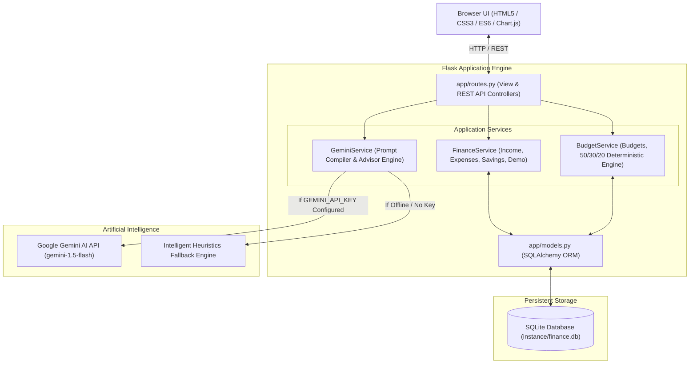

# Personal Finance Advisor Bot

> **An AI-powered full-stack personal finance and wealth management platform designed to track income, categorize expenses, enforce deterministic budgets, monitor savings goals, and generate actionable financial audits using Google Gemini AI.**

---

### **Project Links**

* **Live Demo:** [ADD DEPLOYED DEMO URL]
* **GitHub Repository:** [ADD GITHUB REPOSITORY URL]

*(If deploying to Render, Railway, or Heroku, insert your deployed web app URL above. Insert your GitHub repository remote link after pushing.)*

---

## Overview

**Personal Finance Advisor Bot** is a modern, responsive web application engineered for college students, young professionals, and individuals seeking financial clarity. It replaces cumbersome spreadsheets with an automated personal financial dashboard, built on Indian Rupee (`₹`) standards and equipped with a hybrid intelligence engine combining deterministic budgeting rules with generative AI insights via Google Gemini.

The system is designed with full resilience: when an API key is provided, it leverages Google Gemini AI for personalized recommendations; if the API key is missing or offline, it seamlessly activates a built-in Intelligent Heuristics Engine to maintain complete functionality without crashes.

---

## Key Features

1. **Executive Financial Dashboard**
   * Real-time metrics: Monthly Income, Total Expenses, Net Savings, Savings Rate (%), and Remaining Budget.
   * Interactive **Chart.js** visualizations: 6-month historical Income vs Expense trend and Category Spending breakdown.
   * Live Budget Utilization indicators with dynamic status coloring (Normal, Warning, Over-Budget).
   * Unified quick ledger showing recent inflow and outflow transactions.

2. **Income Management**
   * Record, edit, and delete salary, freelance, allowance, business, and secondary inflows.
   * Filter and aggregate income streams by month, year, source, and search terms.
   * Strict validation enforcing positive amounts and valid dates.

3. **Expense Tracking & Categorization**
   * Log daily and recurring outflows across standard categories: *Food, Rent, Transport, Utilities, Education, Healthcare, Entertainment, Shopping, Bills, Other*.
   * Advanced multi-filter controls: date range, billing month, category, and keyword search.

4. **Monthly Budget Management**
   * Set category-specific monthly spending caps.
   * Live comparison: **Budgeted vs Actual Spending** with remaining balance and percentage utilized.
   * Objective over-budget detection and warning badges without alarmist language.

5. **Automatic Budget Recommendation System**
   * Deterministic budgeting algorithm rooted in the **50/30/20 standard personal finance framework** (50% Needs, 30% Wants, 20% Guaranteed Savings).
   * Automatically calibrates category caps using multi-month historical spending averages.
   * Transparent step-by-step audit trace explaining how each recommended category limit was derived.
   * One-click "Apply Suggested Budget" to instantly enforce recommendations.

6. **Savings & Milestones Tracking**
   * Continuous computation:
     $$\text{Savings} = \text{Total Income} - \text{Total Expenses}$$
     $$\text{Savings Rate} = \left(\frac{\text{Savings}}{\text{Total Income}}\right) \times 100$$
   * Multi-milestone goal tracker (*Emergency Fund, Coding Laptop, Higher Education, Travel*).
   * Real-time progress bars, remaining target amounts, target dates, and quick contribution buttons.
   * Historical 6-month savings momentum line chart.

7. **Google Gemini AI Financial Advisor**
   * Structured prompt engineering passing monthly inflows, outflows, category breakdown, budget utilization, MoM comparison, and active savings goals.
   * Generates structured 6-point financial diagnostics:
     1. Spending Observations
     2. High-Spending Categories
     3. Practical Ways to Reduce Unnecessary Spending
     4. Suggestions for Improving Savings
     5. Budgeting Recommendations
     6. Goal Progress Observations
   * Compliance & Safety: strictly educational; does not pretend to be a licensed advisor, guarantees no investment returns, and includes mandatory compliance disclaimers.
   * Interactive prompt presets and custom query console.

8. **Monthly Financial Statement (Print-Ready)**
   * Complete executive balance sheet for any selected month.
   * Month-over-Month variance analysis (% change in income, expenses, and savings).
   * Top 3 largest spending categories.
   * Dedicated `@media print` CSS styling for one-click clean PDF export.

9. **Unified Transaction Ledger & CSV Export**
   * Unified ledger of credit and debit transactions.
   * Multi-column search, category filter, date filtering, and sorting (date, amount).
   * Client-side and server-side CSV export (`/transactions/export`).

10. **Sample Demo Data Generator**
    * Realistic Indian financial profile (Monthly salary: ₹35,000, freelance payouts, realistic urban living expenses, pre-configured budgets, and savings goals).
    * Independent demo flag (`is_demo=True`) enabling users to populate or clear sample data at any time without touching personal records.

---

## Technology Stack

* **Backend:** Python 3.10+, Flask 3.x, Flask-SQLAlchemy, SQLite
* **Frontend:** HTML5, Modern CSS3 (CSS Variables, Flexbox, Grid), JavaScript (Vanilla ES6+)
* **Data Visualizations:** Chart.js 4.x
* **AI Engine:** Google Gemini API (`google-genai` SDK and Generative Language REST fallback)
* **Testing:** Pytest (24 comprehensive automated tests)
* **Deployment:** Gunicorn, Procfile (Heroku / Render / Railway ready)

---

## Architecture



---

## Project Structure

```
personal-finance-advisor/
│
├── app/
│   ├── __init__.py                 # Flask app factory, custom filters, context processors
│   ├── models.py                   # SQLAlchemy models: Income, Expense, Budget, SavingsGoal
│   ├── routes.py                   # UI view routes and RESTful API endpoints
│   ├── services/
│   │   ├── finance_service.py      # Core transactions, calculations, and demo dataset manager
│   │   ├── budget_service.py       # Budget vs actual tracking & 50/30/20 algorithm
│   │   └── gemini_service.py       # Gemini API client with deterministic heuristics engine
│   ├── templates/
│   │   ├── base.html               # Master layout with responsive sidebar and modal triggers
│   │   ├── dashboard.html          # Main financial dashboard with Chart.js analytics
│   │   ├── income.html             # Inflow management, filtering, and CRUD modals
│   │   ├── expenses.html           # Expense logging, category breakdown, and CRUD modals
│   │   ├── budgets.html            # Category budget limits & automatic generation
│   │   ├── savings.html            # Savings goals, milestones, and contribution tracker
│   │   ├── advisor.html            # Dedicated Gemini AI Financial Advisor interface
│   │   ├── reports.html            # Print-ready monthly statement with MoM variance
│   │   └── transactions.html       # Unified ledger with search, sorting, and CSV export
│   └── static/
│       ├── css/
│       │   └── style.css           # Modern design system, accessible contrast & print styles
│       └── js/
│           ├── main.js             # Modal management, drawer toggle, and UI helpers
│           └── charts.js           # Chart.js renderers (Doughnut, Bar, Line)
│
├── instance/                       # SQLite persistent storage (ignored in git)
├── tests/
│   ├── __init__.py
│   ├── conftest.py                 # Pytest fixtures and in-memory test configuration
│   ├── test_finance.py             # Income, expense, and savings calculations tests
│   ├── test_budgets.py             # Budget vs actual, over-budget & recommendation tests
│   ├── test_savings_goals.py       # Savings goals and contribution logic tests
│   └── test_routes.py              # Route status, demo data flows, and CSV export tests
│
├── .env.example                    # Template environment variables
├── .gitignore                      # Git ignore rules for environments and databases
├── config.py                       # Configuration classes for development, test, and production
├── requirements.txt                # Python package dependencies
├── Procfile                        # Production web process declaration for cloud deployment
├── run.py                          # Application entry point
├── LICENSE                         # MIT License
└── README.md                       # Comprehensive documentation
```

---

## Environment Variables

Copy the provided `.env.example` file to create your local `.env`:

```bash
cp .env.example .env
```

Configure the following variables in `.env`:

```env
# Flask Application Configuration
FLASK_APP=run.py
FLASK_ENV=development
SECRET_KEY=dev-secret-key-change-in-production

# Google Gemini API Key
# Obtain a free key from: https://aistudio.google.com/
GEMINI_API_KEY=your_gemini_api_key_here

# Optional: Specify model (defaults to gemini-1.5-flash)
GEMINI_MODEL=gemini-1.5-flash

# Database Configuration (defaults to sqlite:///instance/finance.db)
DATABASE_URL=sqlite:///instance/finance.db
```

> **Note:** If `GEMINI_API_KEY` is not provided, the application continues to run seamlessly using its built-in Intelligent Heuristics Engine.

---

## Running Locally

Follow these 8 steps to run the application on your local machine:

### 1. Clone the repository
```bash
git clone [ADD GITHUB REPOSITORY URL]
cd personal-finance-advisor
```

### 2. Create a virtual environment
```bash
# On Windows
python -m venv .venv

# On macOS/Linux
python3 -m venv .venv
```

### 3. Activate the virtual environment
```bash
# On Windows (PowerShell)
.\.venv\Scripts\Activate.ps1

# On Windows (Command Prompt)
.\.venv\Scripts\activate.bat

# On macOS/Linux
source .venv/bin/activate
```

### 4. Install dependencies
```bash
pip install -r requirements.txt
```

### 5. Create `.env` file
```bash
cp .env.example .env
```

### 6. Add your Gemini API key (Optional but recommended)
Open `.env` in any text editor and paste your key:
```env
GEMINI_API_KEY=AIzaSy...
```

### 7. Run Flask
```bash
python run.py
```

### 8. Open the application
Open your browser and navigate to:
```
http://127.0.0.1:5000
```

> **Quick Start Tip:** Click **Demo Data &rarr; Load Realistic Sample Data (₹35k)** in the top right menu to immediately populate the application with a realistic Indian personal finance dataset.

---

## Running Automated Tests

Run the complete test suite using `pytest`:

```bash
pytest -v
```

All 24 test cases will execute:
* Adding and updating income
* Adding and updating expenses
* Computing monthly income, expenses, and savings
* Computing savings rate percentages
* Calculating budget vs actual spending
* Detecting over-budget conditions
* Deterministic automatic budget generation
* Savings goals creation and contributions
* Offline AI advisor resilience
* CSV transaction export

---

## Deployment Guide

### Deploying to Render / Railway / Heroku

1. **Procfile**: Already included in the root directory:
   ```text
   web: gunicorn "run:app"
   ```
2. **Environment Variables**: In your cloud hosting dashboard (Render / Railway / Heroku), configure:
   * `SECRET_KEY`: A random 32-character string
   * `GEMINI_API_KEY`: Your Google Gemini API Key
   * `PYTHON_VERSION`: `3.11.9`
3. Push to your GitHub repository and link it to the hosting service.

---

## Screenshots

| View | Preview |
|---|---|
| **Dashboard** |  |
| **Budget Management & Auto-Generation** |  |
| **Gemini AI Financial Advisor** |  |
| **Printable Monthly Statement** |  |

*(Screenshots can be updated with application captures after launching.)*

---

## Future Enhancements

* **Predictive Spending Analytics:** Machine-learning forecasts for end-of-month expenditure based on daily burn rate.
* **Investment Education & Portfolios:** Asset-allocation education covering Mutual Funds (SIPs), Fixed Deposits, and PPF without stock-picking speculation.
* **Goal-Based Recurring Savings Automation:** Webhooks integration to simulate automated transfers toward target milestones.
* **Advanced Financial Health Score:** Multi-dimensional composite scoring (0–100) assessing debt-to-income, emergency preparedness, and savings consistency.
* **Multi-User Authentication:** Secure password hashing (bcrypt), session tokens, and multi-tenant database isolation.
* **Mobile Companion App:** React Native or Progressive Web App (PWA) client for on-the-go receipt capture.

---

## License

This project is licensed under the MIT License - see the [LICENSE](LICENSE) file for details.
